

  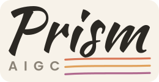

<h1 align="center">Prism AIGC</h1>

<strong>跑在你自己电脑上的短剧 AI 制作工作台</strong>

  
  
  
  

> **导入剧本 → 自动拆集、拆角色 / 场景 / 道具 → 生成分镜与每段提示词 → 在画布上串起资产、关键帧和视频 → 成片管理与海报。**
>
> 生成走你自己的模型 Key。剧本、素材和生成记录都保存在本机，只发送给你自己配置的模型渠道。

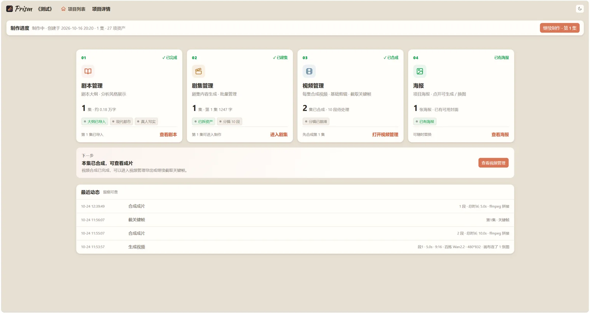

---

## 它解决什么问题

写过 AI 短剧的人大概都遇到过这几件事：

- **提示词靠感觉**：每一段都要重新想景别、机位、光线，人物和场景还经常“长不一样”
- **流程是断的**：拆集、拆资产、分镜、提示词、出图、出视频，散在几个工具和几个文档里
- **交接靠嘴**：分镜格式不统一，换个同事就要重新讲一遍
- **版本找不回**：上次那张更好的图、那条更顺的视频，重跑之后就找不到了
- **资产不复用**：同一件衣服、同一个场景，每集都在重新生成

Prism AIGC 把这些环节收进一个本地工作台：**规范内置、资产复用、全程留痕、产出直接可用**。

---

## 一条流水线，六个环节

### 01 · 剧本：导入即拆

上传 `docx / txt / md`，自动拆集、分析类型与风格、提取人物关系和项目简介。

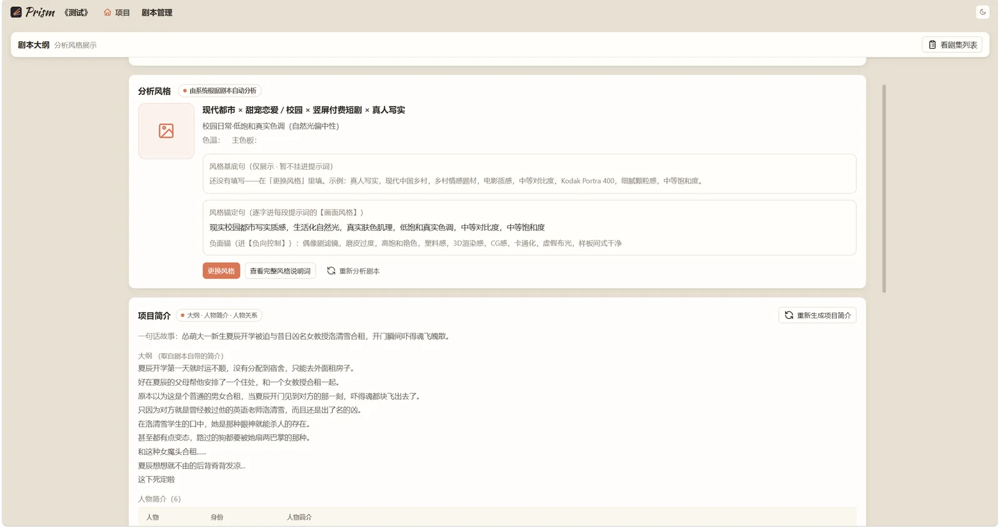 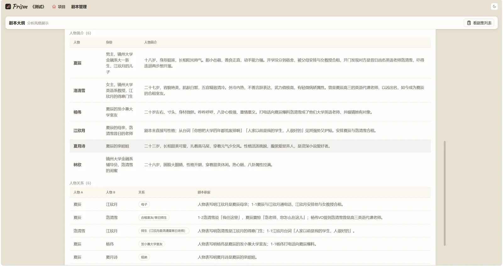

### 02 · 资产：人物、服饰、场景、道具一次做齐

- 角色：大头照 / 服饰 / 定妆照 / 群像
- 场景：全景广角 / 细节
- 道具：按需生成
- 资产按集复用，新一集直接关联，不用从头再来

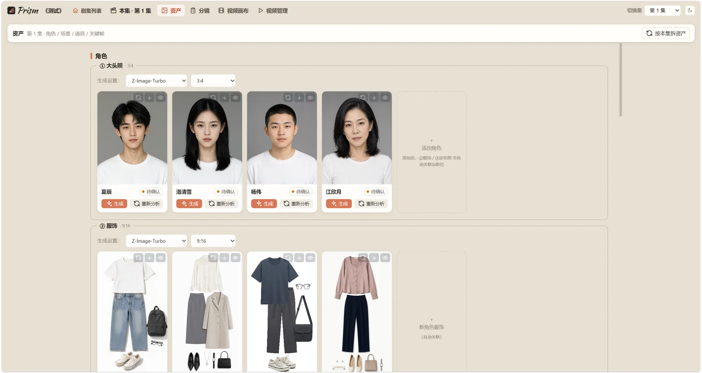 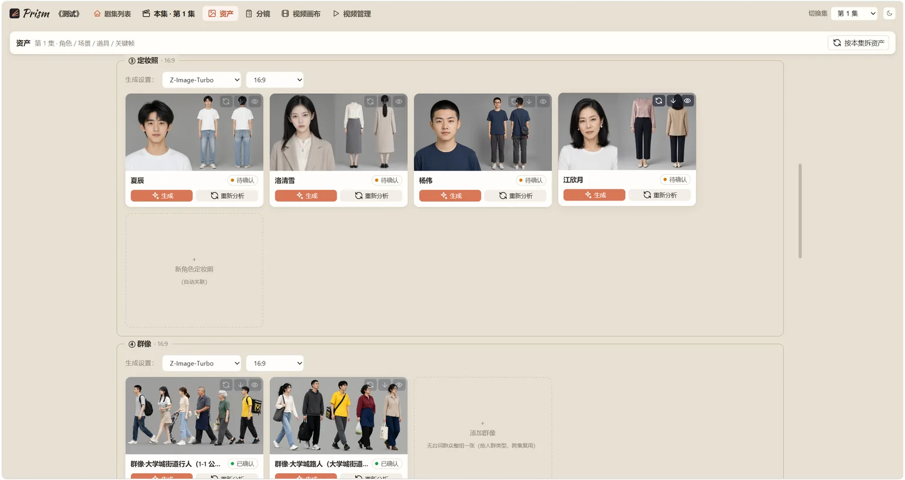

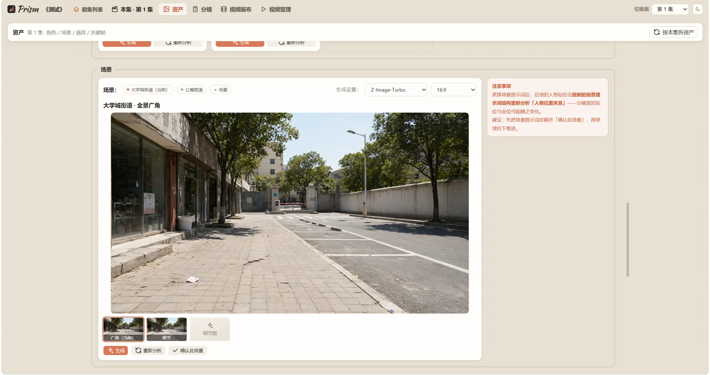

### 03 · 分镜：按场拆段，每段都有镜头表和提示词

自动分段、给景别 / 机位 / 运镜 / 台词 / 音效 / 转场，并生成每段可直接使用的画面提示词。

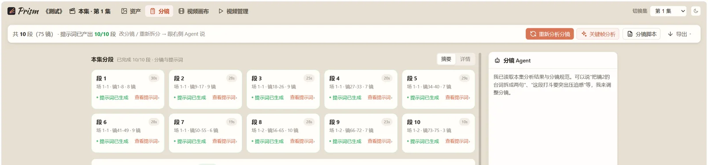

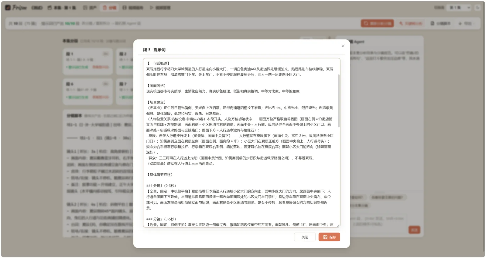

### 04 · 视频画布：把文本、素材、关键帧连起来

- 每段三列：**文本脚本 → 图片素材 → 视频节点**
- 关键帧自动排在视频下方，可拖拽、可连线
- 节点级生成：选模型、选比例、选参考图，结果直接回填节点
- 素材可随时更换：从资产库选，或从本地上传（保留历史版本）

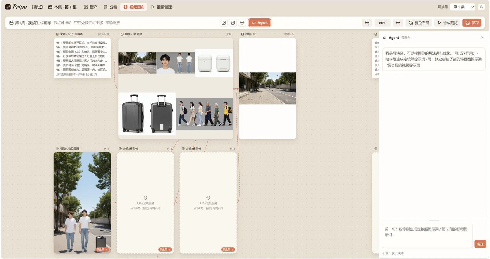

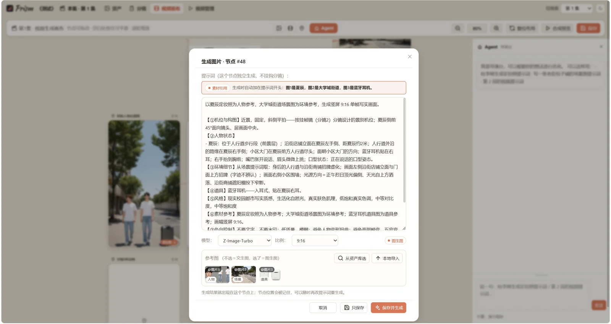 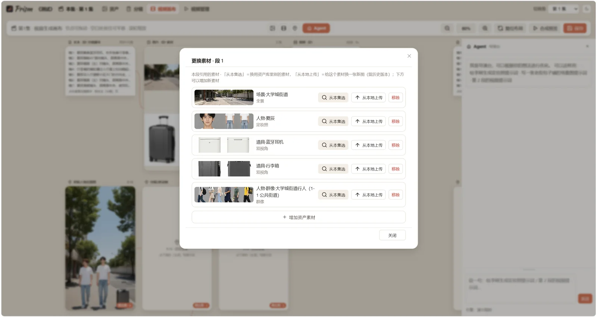

### 05 · 视频管理：生成历史、选用版本、合成成片

- 同一段可以生成很多版，历史都留着
- 选哪一版，成片就按哪一版拼
- 合成成片、逐帧查看、在当前帧截取关键帧

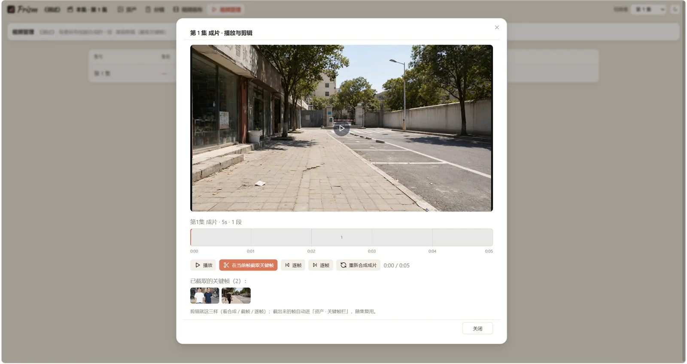

### 06 · 海报与 Agent：从项目简介直接出封面

- 海报支持 3:4 / 16:9 / 2450×800 等比例，可多版本对照
- 海报 Agent 读取项目简介，一次给多个方向，每个版本单独成卡
- 还有分镜 Agent、美术师 Agent、导演 Agent，改分镜、改提示词都可以直接说人话

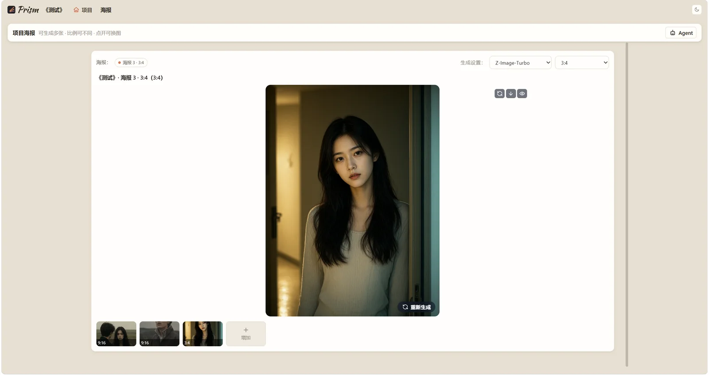 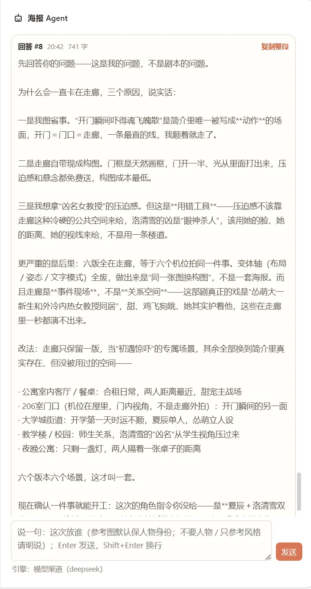

---

## 为什么用起来省事

| | |
|---|---|
| **不用懂提示词工程** | 分析规范内置，镜头表、画面提示词、负面锚都按规范产出 |
| **资产一次做，全剧复用** | 人物、服饰、场景、道具按集关联，避免每集重新生成 |
| **每一步都留痕** | 资产版本、视频历史、变更记录，随时回滚或换回旧版 |
| **数据在自己手里** | 本地 SQLite + 本地素材目录，备份就是拷贝一个文件夹 |
| **自带模型 Key** | 文本、图片、视频渠道都可以接你自己的账号，费用透明 |
| **Windows 解压即用** | 不用装 Python、Node，双击启动，浏览器打开就能用 |

---

## 买断与授权

- **价格**：¥199，一次性买断
- **更新**：终身免费更新
- **赠送**：Prism 分析规范 Skill 包（整理版，随安装包发放）
- **交付**：Windows 绿色版，解压即用
- **不含**：模型 API 费用（各模型服务商自行充值）
- **Mac 版**：开发中，敬请期待

> 分析规范 Skill 包覆盖：剧本分析、角色分析、场景与道具、资产筹备（人物妆造 / 服饰设计 / 场景美术 / 道具）、分镜（景别 / 角度 / 构图 / 光影 / 动势 / 转场 / 运镜 / 情绪表演）、提示词组装、关键帧需求、海报封面。仅限购买者本人使用，禁止转售或公开传播。

---

## 购买方式

  

扫码加微信，备注 **Prism**。付款后发送网盘链接、启动说明和 Skill 包；更新通过微信和网盘同步。

安装与配置见 [快速开始](docs/quick-start.md)。

---

## 系统要求

- **系统**：Windows 10 / 11（64 位）
- **模型**：自备文本 / 图片 / 视频模型渠道（OpenAI 兼容接口、阿里云百炼、ModelScope 等）
- **内存**：建议 8GB 以上
- **磁盘**：素材和视频会占用空间，建议预留充足磁盘
- **网络**：生成时需要联网；项目管理和本地编辑可以离线使用

---

## 常见问题

**Q：我的剧本会上传到哪里？**
A：只发送给你自己配置的模型服务商，不经过 Prism 的服务器。剧本、素材、生成记录都保存在本机 `data/` 目录。

**Q：API Key 存在哪？**
A：保存在本机数据库里，界面只显示掩码；不会上传到任何第三方。

**Q：需要自己准备模型账号吗？**
A：需要。文本、图片、视频都可以接你自己的渠道，用多少充多少，费用不经过我们。

**Q：可以商用吗？**
A：可以用于你自己的商业项目。模型服务条款和生成内容的合规性由使用者自行负责。

**Q：换电脑怎么办？**
A：把整个 `data/` 目录拷贝到新电脑即可，项目和素材都在里面。

**Q：更新怎么拿？**
A：群内和网盘同步；更新时只替换程序目录，`data/` 不动。

**Q：有 Mac 版吗？**
A：目前只有 Windows，Mac 版在开发中。

**Q：送的 Skill 包可以分享给朋友吗？**
A：不可以。Skill 包仅限购买者本人使用，禁止转售、公开或二次分发。

更多问题见 [FAQ](docs/faq.md)，Skill 包内容见 [Skill 包说明](docs/skill-pack.md)。

---

## 更新记录

见 [CHANGELOG.md](CHANGELOG.md)。

---

## 声明

- 本仓库仅用于产品介绍，**不包含源代码和安装包**。
- Prism AIGC 为闭源商业软件，未经授权禁止复制、转售、出租、反编译或二次分发；完整条款见 [授权条款](docs/license-terms.md)。
- 第三方模型服务由对应服务商提供，费用与条款以其官方说明为准。
- 生成内容请遵守当地法律法规及各平台规范。

Prism AIGC · 让创作回到创作本身

